

<strong>Министерство науки и высшего образования Российской Федерации</strong> 

ФЕДЕРАЛЬНОЕ ГОСУДАРСТВЕННОЕ АВТОНОМНОЕ ОБРАЗОВАТЕЛЬНОЕ УЧРЕЖДЕНИЕ ВЫСШЕГО ОБРАЗОВАНИЯ 

<strong>НАЦИОНАЛЬНЫЙ ИССЛЕДОВАТЕЛЬСКИЙ УНИВЕРСИТЕТ ИТМО</strong> 

ITMO University 

ФАКУЛЬТЕТ ПРИКЛАДНОЙ ИНФОРМАТИКИ 

<strong>Отчет по лабораторной работе №2</strong> 

по дисциплине «Введение в облачные технологии» 

<strong>Тема:</strong> «Docker» 

<strong>Выполнила:</strong> 
Чеченко К.С. 
К3260 

502536 

Санкт-Петербург 
2026 г. 

  

1. Цель работы

Упаковка сервиса из Лабы 0 в Docker-образы. Создание «плохого» и «хорошего» Dockerfile, сравнение их характеристик. Поднятие всего стека (**фронтенд**, бэкенд, база данных) через «docker compose», настройка сетевой изоляции и сохранения данных.

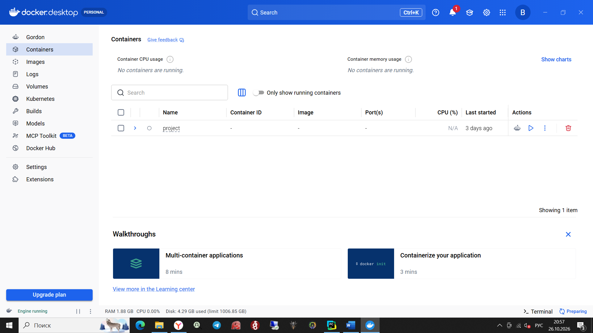

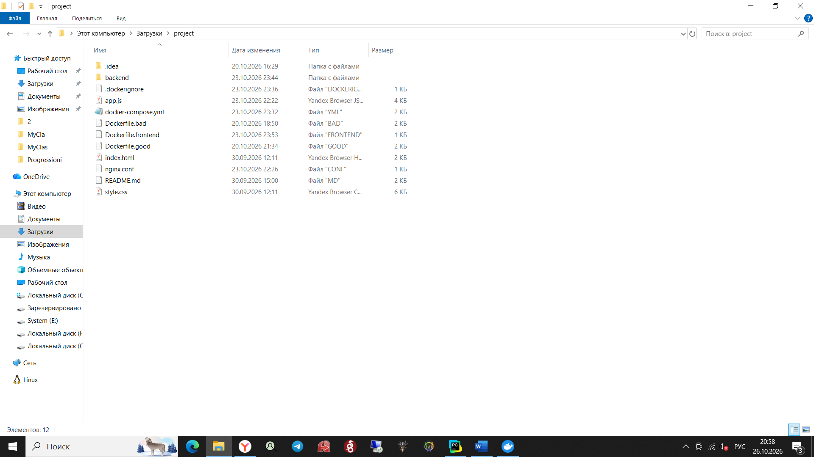

2. «Dockerfile.bad»

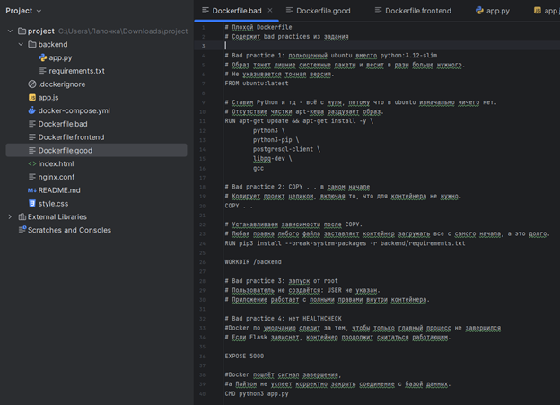

 Реализованные Bad practices:

-  Использование тяжелого базового образа без фиксации версии («ubuntu:latest»). Это раздувает размер образа, тянет за собой кучу лишних системных пакетов, а тег «latest» делает сборку непредсказуемой.

-  Нарушение кеширования слоев: «COPY . .» выполняется до установки зависимостей. Любое изменение в коде (даже в одном файле) полностью сбрасывает кеш, и «pip install» запускается заново.

-  Запуск от root. Это небезопасно и нарушает принцип наименьших привилегий. В таком случае любой процесс внутри контейнера или любой пользователь, попавший в контейнер, получает максимальные права. Если злоумышленник найдет уязвимость в приложении, он сразу получит полный контроль над окружением контейнера, что облегчит ему доступ к данным.

-  Отсутствие «HEALTHCHECK». Docker не понимает, зависло ли приложение, он следит только за тем, чтобы главный процесс не завершился.

-  Использование «shell» формы в «CMD». Python не получает сигналы остановки напрямую, что может привести к некорректному завершению работы и обрыву соединений с БД.

 3. «Dockerfile.good»

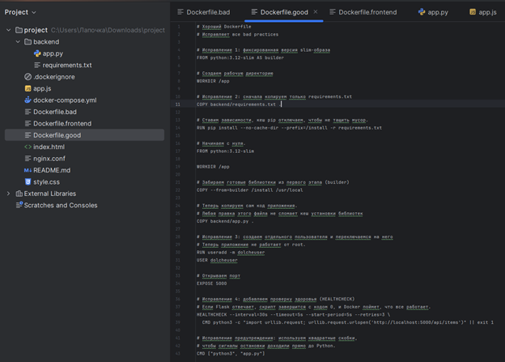

 Как исправлены Вad practices:

-  Размер и безопасность: Используется легковесный образ «python:3.12-slim» с зафиксированной версией.

-  Кеширование: Применен multi-stage build. Сначала копируется только «requirements.txt» и ставятся зависимости, затем копируется код. Изменение кода больше не ломает кеш зависимостей.

-  Пользователь: Создан отдельный пользователь «dolcheuser», приложение работает от его имени.

-  Healthcheck: Добавлена проверка доступности API.

-  Обработка сигналов: «CMD» переведен в JSON-формат.

-  Добавлен файл «.dockerignore» для исключения лишних файлов из сборки.

 4. Сравнение образов

Размер образа

По результатам команды «docker images»:

-  Размер плохого образа: 915 MB (Диск: 244 MB).

-  Размер хорошего образа: 201 MB (Диск: 49.4 MB).

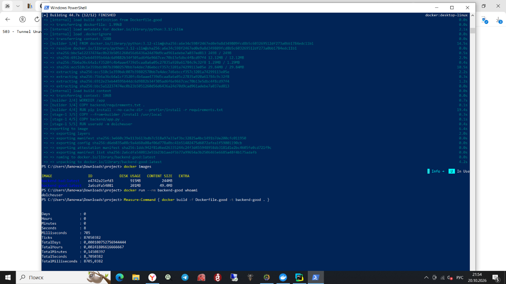

Вывод: хороший образ почти в 5 раз меньше по занимаемому месту на диске.

 Пользователь

-  Команда «docker run --rm backend-bad whoami» возвращает: «root»

-  Команда «docker run --rm backend-good whoami» возвращает: «dolcheuser» (на предыдущем скрине видно)

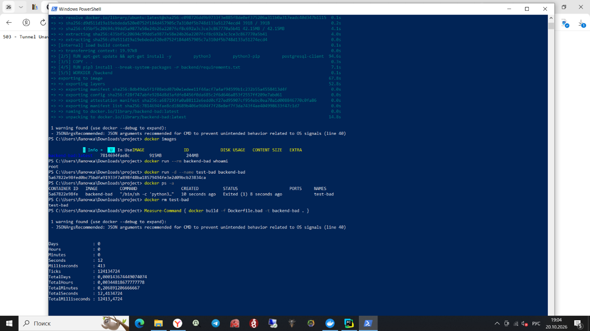

Кеширование (Время пересборки) – есть на предыдущих скринах

Измерение проводилось с помощью «Measure-Command {docker build ...}»:

·       Время сборки плохого образа после изменения одной строки кода: 12.41 сек (пересобираются все слои, включая «apt-get» и «pip install»).

·       Время сборки хорошего образа после изменения кода: 8.7 сек (благодаря многоэтапной сборке слой с установкой зависимостей берется из кеша, пересобирается только слой с копированием кода).

 5. Docker Compose и изоляция сети

Весь стек поднимается одной командой «docker compose up»

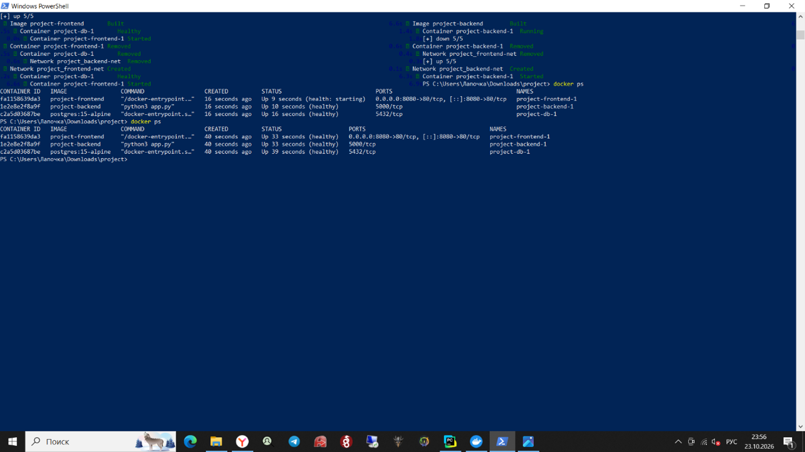

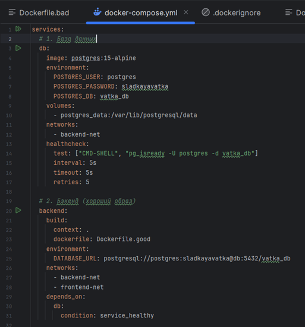

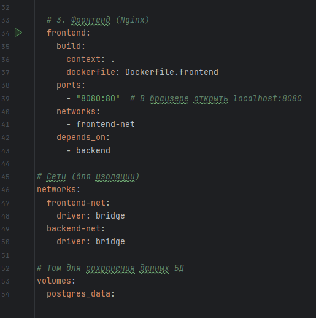

Именованный том

Для сохранения данных БД используется том «postgres_data». При удалении и пересоздании контейнера БД («docker rm»), данные сохраняются, так как они записываются в том на хосте.

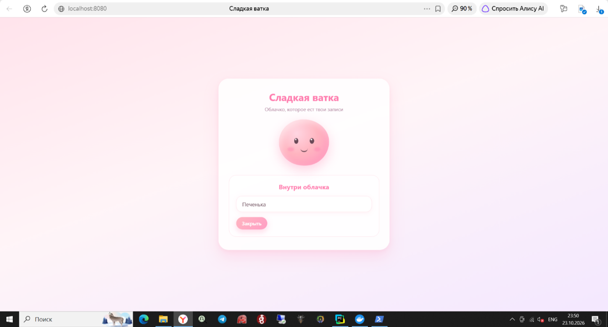

Сетевая изоляция (Изоляция фронта от БД)

Фронтенд и Бэкенд находятся в сети «frontend-net», а Бэкенд и БД — в «backend-net». Сеть «backend-net» недоступна для фронтенда.

Доказательство: Попытка стучаться с фронтенда напрямую к БД:

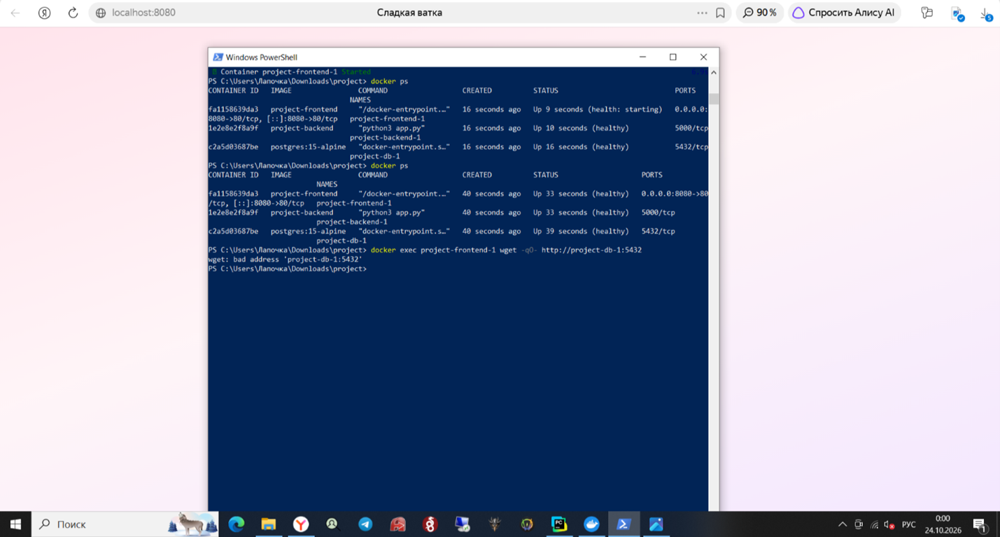

 6. Вывод

Установила Докер на компьютер, почитала, как хорошо и плохо можно собрать Dockerfile, реализовала. Все заработало, в том числе, мой красивый фронтэнд из 0й лабораторной - по-прежнему хорош, порадовалась.  
Поделала скриншоты, составила отчет. Приступаю к звездочке.