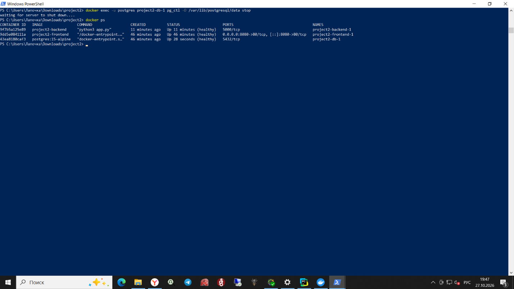
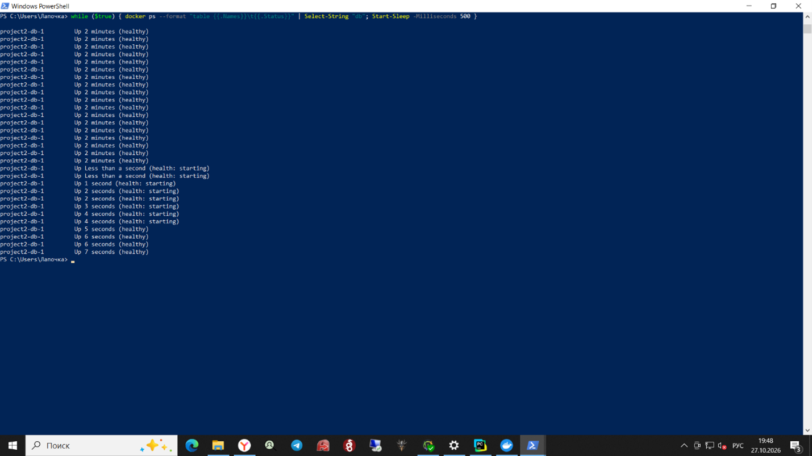
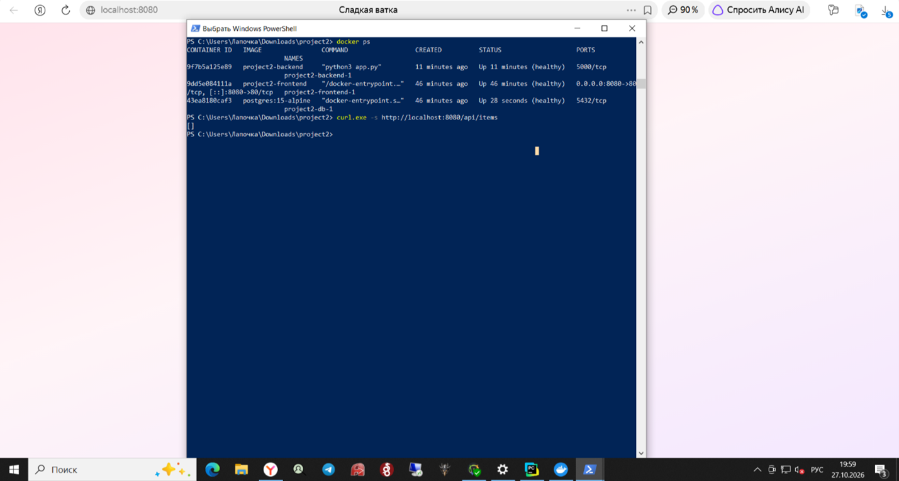
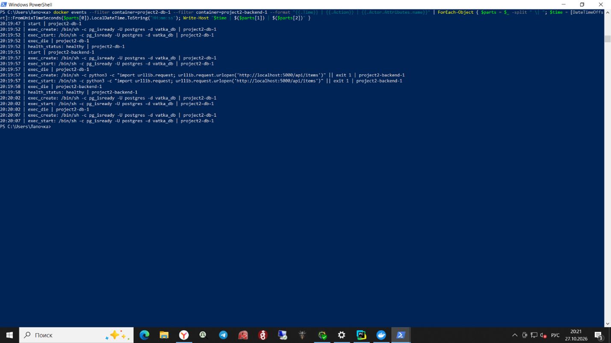
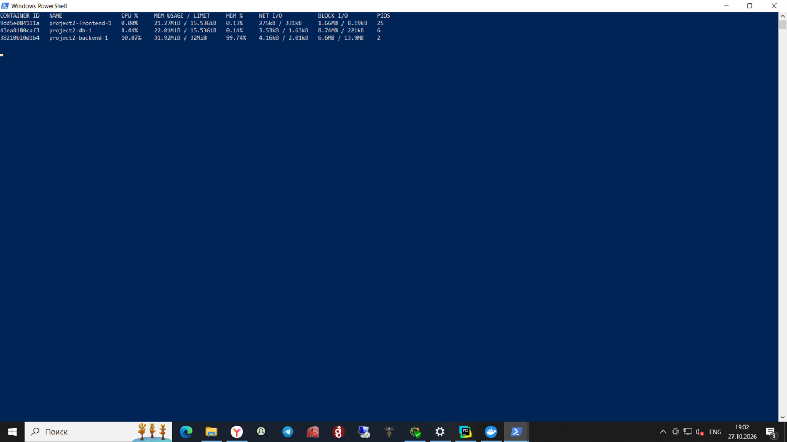
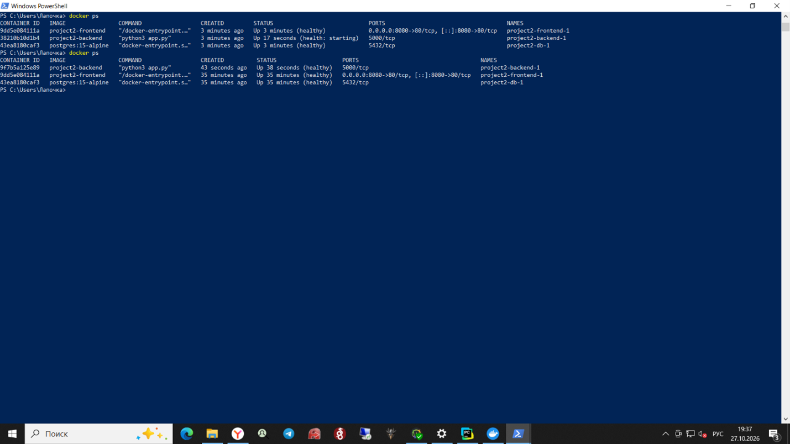

<strong>Министерство науки и высшего образования Российской Федерации</strong> 

ФЕДЕРАЛЬНОЕ ГОСУДАРСТВЕННОЕ АВТОНОМНОЕ ОБРАЗОВАТЕЛЬНОЕ УЧРЕЖДЕНИЕ ВЫСШЕГО ОБРАЗОВАНИЯ 

<strong>НАЦИОНАЛЬНЫЙ ИССЛЕДОВАТЕЛЬСКИЙ УНИВЕРСИТЕТ ИТМО</strong> 

ITMO University 

ФАКУЛЬТЕТ ПРИКЛАДНОЙ ИНФОРМАТИКИ 

<strong>Отчет по лабораторной работе №2 звездочка</strong> 

по дисциплине «Введение в облачные технологии» 

<strong>Тема:</strong> «Устойчивый стек» 

<strong>Выполнила:</strong> 
Чеченко К.С. 
К3260 

502536 

Санкт-Петербург 
2026 г. 

Меняла файл «docker-compose.yml»

А. Самовосстановление

Для обеспечения отказоустойчивости в «docker-compose.yml» были добавлены политики перезапуска и проверки состояния (healthcheck).

Что было настроено:

-  Для базы данных указана политика «restart: unless-stopped». Это гарантирует, что если контейнер упадет, Docker поднимет его снова.

-  Настроен «healthcheck» для БД (команда «pg_isready»). Docker проверяет не только то, что контейнер запущен, но и что PostgreSQL готов принимать подключения.

-  Для бэкенда добавлена зависимость «depends_on» с условием «condition: service_healthy». Это значит, что бэкенд не начнет запускаться, пока база данных не перейдет в статус «healthy».

-  Для бэкенда также добавлен «restart: always» и собственный «healthcheck», проверяющий доступность API по эндпоинту «/api/items».

1.  Во время работы стека был принудительно остановлен сервис базы данных изнутри контейнера.

2.  После этого отслеживался статус контейнеров в реальном времени. Видно, что Docker автоматически перезапустил контейнер БД, и его статус сменился.

3.  Бэкенд успешно переподключился к базе данных после её автоматического перезапуска. Сайт продолжил отвечать. Проверка эндпоинта через curl вернула HTTP-статус 200 OK и пустой список []. Это доказывает, что связь между бэкендом и БД восстановлена (если бы соединения не было, была бы получена ошибка 500).

Бэкенд запускается после готовности БД:

Б. Лимиты под нагрузкой

Для предотвращения ситуации, когда один из сервисов «съест» все ресурсы хост-машины, были настроены лимиты CPU и RAM.

1. Установка лимитов

Сначала был задан для бэкенда лимит памяти в 32MB и была запущена нагрузку циклом запросов. С помощью команды «docker stats» видно, что потребление памяти достигло 99% от лимита (31.92 из 32). Из-за нехватки памяти контейнер начинает работать медленнее или может быть убит ядром Linux с ошибкой.

2. Подбор стабильных значений

После этого был изменен лимит на 256MB и перезапущен стек.

Под той же нагрузкой по «docker stats»:

-  Потребление памяти бэкендом составило 64.02MiB (25% от лимита).

-  Потребление CPU составило всего 0.20% от выделенного 1 ядра.

С. Вывод:  
Придумывала, как именно можно убить контейнер бд, чтобы Докер считал это внутренним сбоем, а не отключением мной контейнера намеренно.  
Для второго задания думала, как можно зафиксировать момент падения бэкенда, ибо на все восстанавливается раньше, чем я успеваю вписать стандартный docker ps.